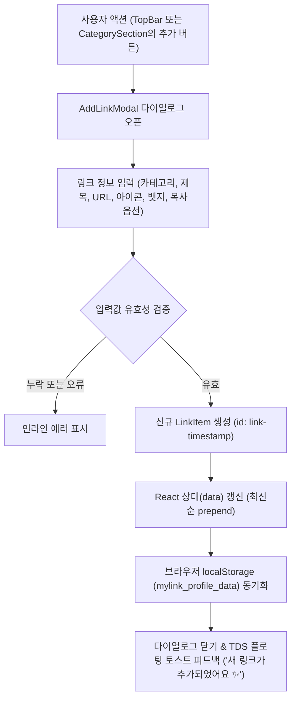

# 📋 링크 추가 기능 구현 계획 및 태스크 (Tasks)

## 1. 개요 (Overview)
- **작업명**: 다이얼로그 기반 링크 추가 기능 및 로컬 상태(`localStorage`) 연동
- **기준 문서**: `docs/PRD.md` (F-402, 6.3 소유자 시나리오 2단계) & `design.md` (토스 디자인 시스템 핸드오프 규격)
- **목표**: 별도의 백엔드 서버 없이도 브라우저 LocalStorage와 React 로컬 상태를 기반으로 링크를 손쉽게 추가하고 실시간으로 반영하는 시연 가능한 UI/UX 완성

---

## 2. 구현 계획 (Implementation Plan)

---

## 3. 세부 태스크 체크리스트 (Task Checklist)

### Phase 1: 기반 UI 컴포넌트 및 토큰 구축
- [x] **TDS 규격 `Input` 컴포넌트 개발 (`@/components/ui/input.tsx`)**
  - [x] 12px 라운드 (`radius-m`), `bg-[#F9FAFB]`, 1px `border-[#E5E8EB]`
  - [x] 포커스 시 토스 블루 (`border-[#3182F6]`, `ring-3 ring-[#3182F6]/15`, `bg-white`)
  - [x] 에러 상태 스타일링 (`error: border-[#F04452]`, 에러 배경)
  - [x] 비활성화 상태 및 웹 접근성 고려

### Phase 2: 링크 추가 다이얼로그 (`AddLinkModal.tsx`) 개발
- [x] **shadcn/ui `Dialog` 기반 모달 레이아웃 구성**
  - [x] TDS 모달 스타일 (20px 라운드, `shadow-dialog`, 딤드 스크림 오버레이)
  - [x] 모바일 최적화 스크롤 영역 (`max-h-[90vh] overflow-y-auto`)
- [x] **다이얼로그 내부 입력 폼 필드 구성**
  - [x] 대상 카테고리 선택 드롭다운 (기본값 자동 매핑)
  - [x] 링크 제목 (`title`, 필수) & 인라인 에러 처리
  - [x] 보조 설명 (`subtitle`, 선택)
  - [x] URL / 값 (`url`, 필수) & `https://` 자동 보정 로직
  - [x] URL 입력 시 아이콘 자동 감지 및 추천 스마트 UX
  - [x] 6종 아이콘 프리셋 선택 그리드 (`GitHub`, `Velog`, `프로젝트`, `LinkedIn`, `이메일`, `기본 링크`)
  - [x] 강조 뱃지 문구 및 5색 컬러 칩 (`blue`, `green`, `yellow`, `red`, `grey`) 선택과 실시간 프리뷰
  - [x] 클릭 시 클립보드 복사 전용 옵션 (`isCopyAction`) 토글
- [x] **버튼 및 인터랙션**
  - [x] 취소 버튼 (`variant="secondary"`)
  - [x] 추가하기 버튼 (`variant="primary"`)
  - [x] ESC 키 및 바깥 영역 클릭 시 안전한 닫기 처리

### Phase 3: 진입점 UI 연결
- [x] **카테고리 섹션 (`CategorySection.tsx`) 확장**
  - [x] 카테고리 헤더 우측에 `+ 추가` 버튼 추가
  - [x] 클릭 시 해당 카테고리가 기본 선택된 채로 다이얼로그 호출
  - [x] 카테고리 내 링크가 비어있을 때 안내 UI 및 추가 유도 버튼 렌더링
- [x] **상단 글로벌 네비게이션 (`TopBar.tsx`) 확장**
  - [x] 상단 우측 액션 그룹에 `+ 추가` 버튼 추가 (전체 카테고리 대상 추가 가능)

### Phase 4: 상태 관리 및 영속화 연동
- [x] **메인 페이지 (`page.tsx`) 상태 핸들러 구현**
  - [x] `isAddLinkOpen`, `targetCategoryId` 상태 제어
  - [x] `handleAddLink` 구현: 신규 `LinkItem` 생성 및 카테고리 배열 앞단(최신순)에 추가
  - [x] React State 갱신 및 브라우저 `localStorage` (`mylink_profile_data`) 즉시 동기화
  - [x] 추가 성공 시 TDS 플로팅 토스트 2.4초 자동 노출
  - [x] 데이터 초기화(🔄) 시 Mock Data 원복 동작 유지

### Phase 5: 코드 품질 및 빌드 검증
- [x] **Next.js 16 / React 19 호환성 검증**
  - [x] `react-hooks/set-state-in-effect` 린트 에러 해소 (`queueMicrotask` 및 Key 리셋 패턴 적용)
  - [x] `` 웹 접근성 및 alt prop 처리
- [x] **TypeScript 타입 검사 및 프로덕션 빌드 (`npm run build`) 통과**
- [x] **ESLint (`npm run lint`) 무결성 검증 (0 errors, 0 warnings)**
