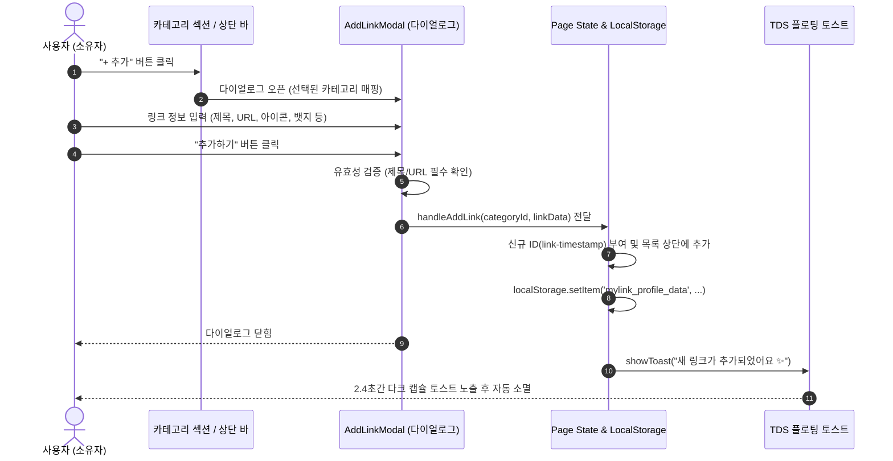

# 🚀 마이링크(MyLink) 링크 추가 기능 워크스루 (Walkthrough)

본 문서는 `docs/PRD.md`에 명시된 링크 추가 기능(F-402, 소유자 시나리오 2단계)을 다이얼로그(Modal) 및 브라우저 로컬 상태(`localStorage`) 기반으로 완성한 내역을 설명하고 검증하는 워크스루 가이드입니다.

---

## 1. 주요 기능 및 변경 사항 요약

| 구분 | 컴포넌트 | 기능 및 디자인 스펙 |
| :--- | :--- | :--- |
| **신규** | [`Input`](file:///Users/yh/Desktop/청운대학교%203학년%202학기/06%20아이디어를현실로바이브코딩-(사)/01%20my-link-ch/mylink/src/components/ui/input.tsx) | 토스 디자인 시스템(TDS) 공식 규격의 텍스트 인풋 프리미티브 (`radius-m`, `12px`, focus blue ring, error state) |
| **신규** | [`AddLinkModal`](file:///Users/yh/Desktop/청운대학교%203학년%202학기/06%20아이디어를현실로바이브코딩-(사)/01%20my-link-ch/mylink/src/components/profile/AddLinkModal.tsx) | 링크 정보(카테고리, 제목, 설명, URL, 아이콘, 뱃지, 복사옵션)를 입력받는 다이얼로그 |
| **확장** | [`CategorySection`](file:///Users/yh/Desktop/청운대학교%203학년%202학기/06%20아이디어를현실로바이브코딩-(사)/01%20my-link-ch/mylink/src/components/profile/CategorySection.tsx) | 각 카테고리 헤더에 `+ 추가` 버튼 배치 (클릭 시 해당 카테고리가 기본 선택됨) |
| **확장** | [`TopBar`](file:///Users/yh/Desktop/청운대학교%203학년%202학기/06%20아이디어를현실로바이브코딩-(사)/01%20my-link-ch/mylink/src/components/profile/TopBar.tsx) | 상단 글로벌 바에 `+ 추가` 액션 버튼 추가 |
| **확장** | [`page.tsx`](file:///Users/yh/Desktop/청운대학교%203학년%202학기/06%20아이디어를현실로바이브코딩-(사)/01%20my-link-ch/mylink/src/app/page.tsx) | 신규 링크 생성 핸들러, React state 및 `localStorage` 영속화 동기화, 플로팅 토스트 연동 |

---

## 2. 사용자 여정 (User Journey & Interaction Flow)



---

## 3. 다이얼로그 폼 상세 기능

### 3.1 스마트 URL 및 아이콘 자동 감지
- URL 입력창에 주소를 입력하면 사용자 의도를 파악하여 아이콘이 자동으로 전환됩니다:
  - `github.com` 포함 시 ➔ **GitHub** 아이콘 자동 선택
  - `velog.io` 포함 시 ➔ **Velog** 아이콘 자동 선택
  - `linkedin.com` 포함 시 ➔ **LinkedIn** 아이콘 자동 선택
  - `mailto:` 또는 이메일 주소 입력 시 ➔ **이메일** 아이콘 자동 선택 + **복사 전용 옵션** 자동 활성화

### 3.2 직관적인 아이콘 프리셋 그리드
- 지원 아이콘: `GitHub`, `Velog`, `프로젝트(FolderGit2)`, `LinkedIn`, `이메일(Mail)`, `기본 링크(Link2)`
- 클릭 한 번으로 선택 상태가 토스 블루 테두리와 배경으로 시각화됩니다.

### 3.3 실시간 뱃지 프리뷰 및 5색 팔레트
- 뱃지 문구(예: `NEW`, `HOT`, `추천`)를 입력하면 상단에 shadcn/ui TDS 뱃지 미리보기가 즉시 렌더링됩니다.
- 블루, 그린, 옐로우, 레드, 그레이 5가지 TDS 테마 칩 중 원하는 색상을 클릭하여 지정할 수 있습니다.

### 3.4 복사 전용 링크 (`isCopyAction`)
- "클릭 시 클립보드 복사 전용"을 체크하면:
  - 입력 라벨이 "복사할 값 (이메일 등)"으로 동적 변경됩니다.
  - 생성된 카드는 새 창으로 이동하지 않고, 클릭 시 해당 값이 클립보드에 복사되며 전용 토스트가 뜹니다.

---

## 4. 로컬 스토리지 검증 및 데이터 구조

생성된 링크 데이터는 `localStorage.getItem("mylink_profile_data")`를 통해 다음과 같은 표준 규격으로 영속 보관됩니다:

```json
{
  "id": "link-1730727000000",
  "title": "모던 포트폴리오 웹",
  "subtitle": "Next.js 16과 Tailwind로 제작한 개인 웹",
  "url": "https://jieun-portfolio.vercel.app",
  "icon": "project",
  "badge": {
    "text": "NEW",
    "variant": "blue"
  },
  "isCopyAction": false
}
```

> [!TIP]
> **시연 데이터 초기화 방법**  
> 상단 글로벌 바의 왼쪽 첫 번째 **회전 화살표(RotateCcw)** 아이콘을 클릭하면 언제든지 `src/data/mockData.json`의 원본 표준 더미 데이터로 깨끗하게 복원됩니다.

---

## 5. 검증 결과 (Verification Results)

1. **빌드 검증 (`npm run build`)**:  
   - Next.js 16.4.4 (webpack) 정적 페이지 생성 및 TypeScript 타입 검사 성공 완료 (에러 0건).
2. **린트 검증 (`npm run lint`)**:  
   - React 19의 `react-hooks/set-state-in-effect` 룰 및 Next.js 이미지 접근성 규칙 준수 완료 (0 errors, 0 warnings).
