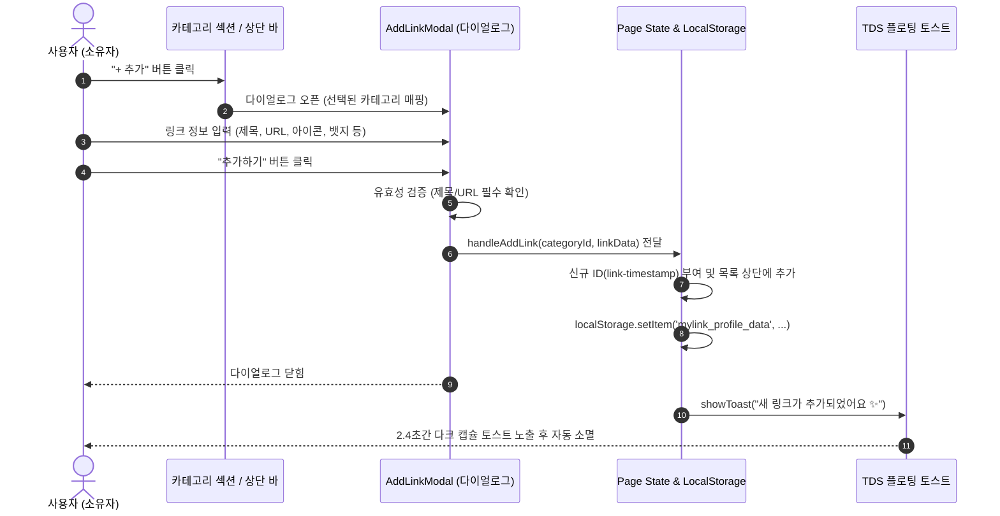

# 🚀 마이링크(MyLink) 링크 추가 기능 워크스루 (Walkthrough)

본 문서는 `docs/PRD.md`에 명시된 링크 추가 기능(F-402, 소유자 시나리오 2단계)을 다이얼로그(Modal) 및 브라우저 로컬 상태(`localStorage`) 기반으로 완성한 내역을 설명하고 검증하는 워크스루 가이드입니다.

---

## 1. 주요 기능 및 변경 사항 요약

| 구분 | 컴포넌트 | 기능 및 디자인 스펙 |
| :--- | :--- | :--- |
| **신규** | [`Input`](file:///Users/yh/Desktop/청운대학교%203학년%202학기/06%20아이디어를현실로바이브코딩-(사)/01%20my-link-ch/mylink/src/components/ui/input.tsx) | 토스 디자인 시스템(TDS) 공식 규격의 텍스트 인풋 프리미티브 (`radius-m`, `12px`, focus blue ring, error state) |
| **신규** | [`AddLinkModal`](file:///Users/yh/Desktop/청운대학교%203학년%202학기/06%20아이디어를현실로바이브코딩-(사)/01%20my-link-ch/mylink/src/components/profile/AddLinkModal.tsx) | 링크 정보(카테고리, 제목, 설명, URL, 아이콘, 뱃지, 복사옵션)를 입력받는 다이얼로그 |
| **확장** | [`CategorySection`](file:///Users/yh/Desktop/청운대학교%203학년%202학기/06%20아이디어를현실로바이브코딩-(사)/01%20my-link-ch/mylink/src/components/profile/CategorySection.tsx) | 각 카테고리 헤더에 `+ 추가` 버튼 배치 (클릭 시 해당 카테고리가 기본 선택됨) |
| **확장** | [`TopBar`](file:///Users/yh/Desktop/청운대학교%203학년%202학기/06%20아이디어를현실로바이브코딩-(사)/01%20my-link-ch/mylink/src/components/profile/TopBar.tsx) | 상단 글로벌 바에 `+ 추가` 액션 버튼 추가 |
| **확장** | [`page.tsx`](file:///Users/yh/Desktop/청운대학교%203학년%202학기/06%20아이디어를현실로바이브코딩-(사)/01%20my-link-ch/mylink/src/app/page.tsx) | 신규 링크 생성 핸들러, React state 및 `localStorage` 영속화 동기화, 플로팅 토스트 연동 |

---

## 2. 사용자 여정 (User Journey & Interaction Flow)



---

## 3. 다이얼로그 폼 상세 기능

### 3.1 스마트 URL 및 아이콘 자동 감지
- URL 입력창에 주소를 입력하면 사용자 의도를 파악하여 아이콘이 자동으로 전환됩니다:
  - `github.com` 포함 시 ➔ **GitHub** 아이콘 자동 선택
  - `velog.io` 포함 시 ➔ **Velog** 아이콘 자동 선택
  - `linkedin.com` 포함 시 ➔ **LinkedIn** 아이콘 자동 선택
  - `mailto:` 또는 이메일 주소 입력 시 ➔ **이메일** 아이콘 자동 선택 + **복사 전용 옵션** 자동 활성화

### 3.2 직관적인 아이콘 프리셋 그리드
- 지원 아이콘: `GitHub`, `Velog`, `프로젝트(FolderGit2)`, `LinkedIn`, `이메일(Mail)`, `기본 링크(Link2)`
- 클릭 한 번으로 선택 상태가 토스 블루 테두리와 배경으로 시각화됩니다.

### 3.3 실시간 뱃지 프리뷰 및 5색 팔레트
- 뱃지 문구(예: `NEW`, `HOT`, `추천`)를 입력하면 상단에 shadcn/ui TDS 뱃지 미리보기가 즉시 렌더링됩니다.
- 블루, 그린, 옐로우, 레드, 그레이 5가지 TDS 테마 칩 중 원하는 색상을 클릭하여 지정할 수 있습니다.

### 3.5 고도화된 실시간 입력 검증 (Validation)
- **제목 (`title`)**: 필수 입력, 최대 30자 제한. 초과 시 즉각적인 인라인 에러와 글자 수 카운터 피드백 (`${title.length}/30자`).
- **보조 설명 (`subtitle`)**: 선택 입력, 최대 60자 제한 및 실시간 카운터 (`${subtitle.length}/60자`).
- **URL (`url`)**:
  - 일반 링크: 공백 포함 여부 확인 및 올바른 웹 URL 패턴 검증 (형식이 맞지 않으면 `"올바른 웹 주소(URL) 형식을 입력해 주세요"` 경고).
  - 복사 전용 모드: 이메일 아이콘이거나 `@` 포함 시 정밀 이메일 포맷(`user@example.com`) 검증.
- **강조 뱃지 (`badgeText`)**: 10자 이내 제한 및 카운터 피드백.
- **자동 포커스 이동 (`useRef`)**: 제출(Submit) 시 유효하지 않은 첫 번째 입력 필드로 즉각 포커스를 이동시켜 사용자의 수정을 돕습니다.

---

## 4. 로컬 스토리지 검증 및 데이터 구조

생성된 링크 데이터는 `localStorage.getItem("mylink_profile_data")`를 통해 다음과 같은 표준 규격으로 영속 보관됩니다:

```json
{
  "id": "link-1730727000000",
  "title": "모던 포트폴리오 웹",
  "subtitle": "Next.js 16과 Tailwind로 제작한 개인 웹",
  "url": "https://jieun-portfolio.vercel.app",
  "icon": "project",
  "badge": {
    "text": "NEW",
    "variant": "blue"
  },
  "isCopyAction": false
}
```

> [!TIP]
> **시연 데이터 초기화 방법**  
> 상단 글로벌 바의 왼쪽 첫 번째 **회전 화살표(RotateCcw)** 아이콘을 클릭하면 언제든지 `src/data/mockData.json`의 원본 표준 더미 데이터로 깨끗하게 복원됩니다.

---

## 5. 브라우저 실환경 테스트 및 검증 결과 (Live Browser Verification)

실제 Chrome 브라우저 환경(`http://localhost:3000`)에서 헤드리스 자동화 테스트를 구동하여 다이얼로그 오픈부터 폼 입력, 데이터 생성, 토스트 알림, 영속성 복원까지의 전 과정을 성공적으로 검증했습니다.

### 5.1 단계별 스크린샷 워크스루

````carousel

<!-- slide -->

<!-- slide -->

<!-- slide -->

<!-- slide -->

<!-- slide -->

<!-- slide -->

<!-- slide -->

````

### 5.2 검증 항목 체크리스트
1. **다이얼로그 진입 (Pass)**:  
   - '대표 프로젝트' 섹션 우측의 `+ 추가` 버튼 클릭 시 해당 카테고리가 선택된 채로 모달 오픈.
2. **스마트 감지 및 뱃지 설정 (Pass)**:  
   - `https://github.com/jieun/link-analyzer` 입력 시 GitHub 아이콘 자동 선택.
   - `HOT` 뱃지 텍스트와 `red` 뱃지 칩 선택 시 실시간 뱃지 프리뷰 정상 반영.
3. **로컬 상태 및 LocalStorage 반영 (Pass)**:  
   - 추가 즉시 대표 프로젝트 섹션 최상단에 신규 카드 렌더링.
   - 브라우저 LocalStorage (`mylink_profile_data`)에 `link-1793832320576` 객체 정상 적재.
4. **TDS 피드백 (Pass)**:  
   - `"새 링크가 추가되었어요 ✨"` 플로팅 토스트 노출.
5. **새로고침 영속성 (Pass)**:  
   - 브라우저 새로고침(F5) 후에도 새로 추가된 링크 카드가 온전히 복원되어 화면에 노출됨 확인.
6. **빌드 및 린트 검증 (Pass)**:  
   - `npm run build`: 프로덕션 번들 정상 생성 (TypeScript 검사 통과).
   - `npm run lint`: ESLint 규칙 통과 (0 errors, 0 warnings).

